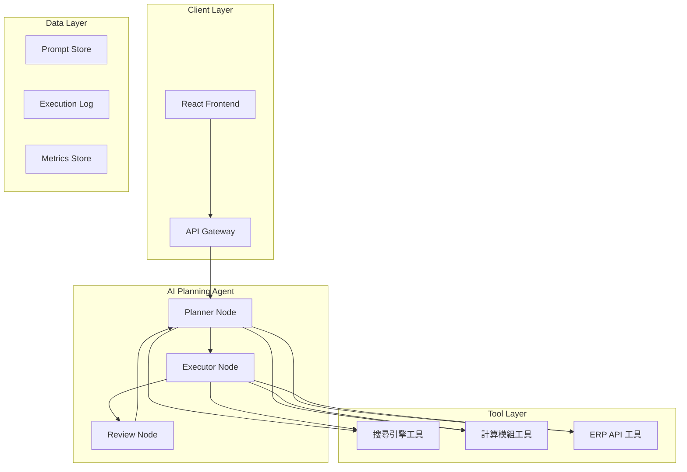
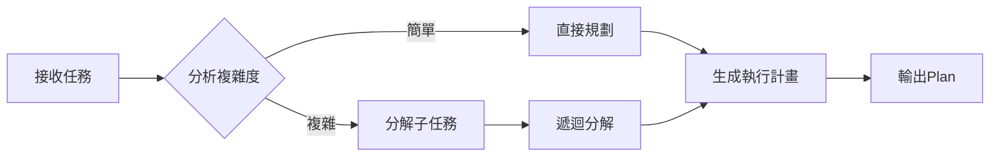
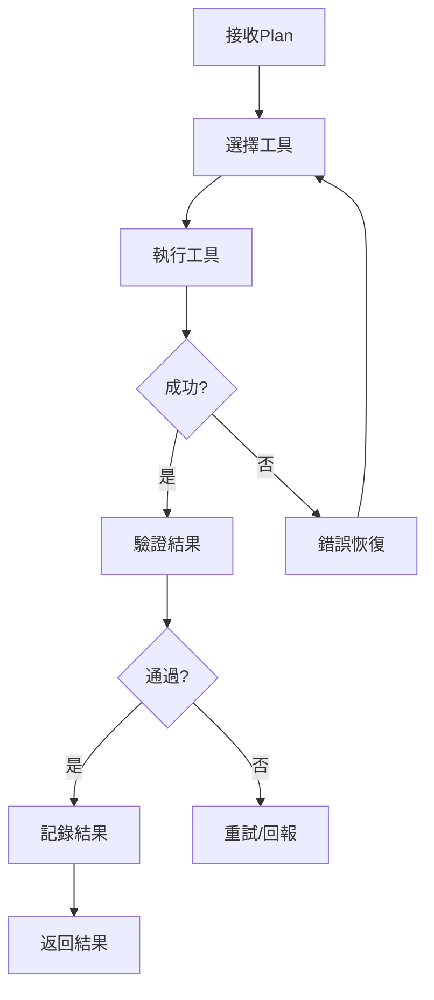
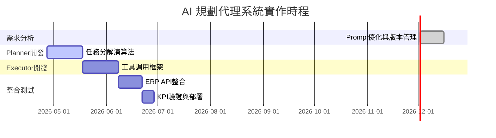

# AI 規劃代理系統規格書

## 1. 專案概述

| 項目 | 內容 |
|------|------|
| 專案名稱 | AI 規劃代理系統 (AI Planning Agent) |
| 專案類型 | ERP AI 代理監控系統 |
| 核心功能 | 支援 Planning 模式自主任務分解，實現 Plan-and-Solve 策略 |
| 目標使用者 | ERP 系統管理員、生產計劃人員、庫存管理人員 |
| KPI 目標 | 準確率 > 95%，ROI > 200% |

## 2. 系統架構

### 2.1 整體架構圖



### 2.2 核心元件說明

| 元件 | 職責 | 技術 |
|------|------|------|
| Planner Node | 任務分解、策略選擇、優化迭代 | LangGraph StateGraph |
| Executor Node | 執行工具、結果驗證、錯誤恢復 | LangGraph Node |
| Review Node | 成果審核、品質檢查、決策確認 | LangGraph Node |
| Tool Integrations | 搜尋、計算、ERP API 整合 | MCP 協定 |

## 3. 功能規格

### 3.1 Planner 模組



**功能**：
- 任務複雜度評估
- 自動任務分解（遞迴結構）
- 策略選擇（平行/串行/混合）
- 執行計畫生成

**輸入**：使用者任務描述
**輸出**：結構化執行計畫（含子任務清單、順序、依賴關係）

### 3.2 Executor 模組



**功能**：
- 工具選擇與調用
- 執行結果驗證
- 錯誤檢測與恢復
- 結果格式化

**輸入**：執行計畫
**輸出**：執行結果與狀態

### 3.3 Tool Integrations

| 工具類型 | 功能 | ERP 整合 |
|----------|------|----------|
| 搜尋引擎 | 文件/資料庫檢索 | 料號、BOM、客户搜尋 |
| 計算模組 | 數學運算、庫存計算 | MRP 運算、排程計算 |
| ERP API | 資料讀寫 | 訂單、庫存、採購 API |

### 3.4 Review Node

- 檢查 Planner 輸出品質
- 驗證 Executor 執行結果
- 異常狀況處理
- 人機協作確認

## 4. 實作時程



| 階段 | 任務 | 負責人 | 時程 | 資源 |
|------|------|--------|------|------|
| 1 | 需求分析與Prompt優化 | AI架構師 | 2週 | Prompt Store |
| 2 | Planner模組開發 | 後端工程師 | 3週 | LangGraph |
| 3 | Executor模組開發 | 後端工程師 | 3週 | LangGraph |
| 4 | 工具整合（搜尋/計算/ERP）| 後端工程師 | 2週 | MCP |
| 5 | 測試與KPI驗證 | QA工程師 | 2週 | 測試框架 |
| 6 | 部署與優化 | DevOps | 1週 | Docker/K8s |

## 5. 預算明細

| 項目 | 金額（萬）| 佔比 |
|------|-----------|------|
| 人力成本（6人/月）| 300 | 60% |
| 雲端運算資源 | 100 | 20% |
| 軟體授權 | 50 | 10% |
| 教育訓練 | 30 | 6% |
|  Contingency | 20 | 4% |
| **合計** | **500** | 100% |

## 6. 風險管理矩陣

| 風險 | 機率 | 影響 | 嚴重性 | 對策 |
|------|------|------|--------|------|
| Prompt不穩定 | 高 | 高 | 🔴 | 版本管理 + A/B測試 |
| API成本過高 | 中 | 中 | 🟡 | 快取機制 + 錯誤重試 |
| ERP整合複雜度 | 高 | 高 | 🔴 | Mock API先行 |
| 準確率未達標 | 中 | 高 | 🔴 | 持續學習 + 反饋機制 |

## 7. Prompt 模板範例

### 7.1 Planner Prompt

```
你是一位專業的ERP AI規劃代理，負責將複雜任務分解為可執行的子任務。

## 任務
{user_task}

## 上下文
{context}

## 輸出格式
請輸出JSON格式的執行計畫：
{
  "tasks": [
    {
      "id": "task_1",
      "description": "子任務描述",
      "dependencies": [],
      "estimated_time": "minutes",
      "tools_needed": ["tool1", "tool2"]
    }
  ],
  "strategy": "parallel|serial|mixed",
  "confidence": 0.95
}
```

### 7.2 Executor Prompt

```
你是一位專業的ERP任務執行代理，負責執行具體的任務步驟。

## 執行計畫
{plan}

## 可用工具
{available_tools}

## 請執行並回報結果
```

## 8. 下一步

1. ✅ 完成系統規格書
2. ⏳ 實作 Planner 模組
3. ⏳ 實作 Executor 模組
4. ⏳ 建立工具整合層
5. ⏳ KPI 驗證機制建置