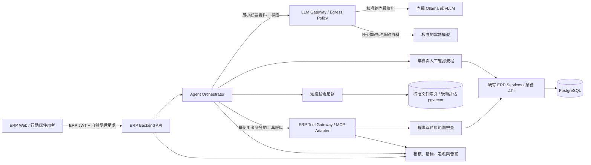

# ProMES ERP AI Agent 隱私防護與分階段修改方案

> 文件版本：2.2
> 更新日期：2026-11-03
> 狀態：依目前程式與部署現況整理之提案；不代表功能已部署或已核准執行

## 1. 目的與設計原則

本計畫提出一條可逐步驗證的路徑，讓 ERP 使用者能以自然語言查詢、理解和準備業務作業，同時保留現有 ERP API、服務層、RBAC 和簽核流程作為唯一的業務權威。

### 本系統的建議結論

1. 首期只做登入後的「製造工單/WIP 唯讀助理」；不以跨模組自主代理或自動交易作為 MVP。
2. ERP 資料只經過固定、具型別、白名單的後端工具；不提供模型直接連 PostgreSQL、任意 SQL、shell、瀏覽器操作或通用 HTTP 工具。
3. 即時數字由既有 ERP Service/查詢 API 取得並計算，LLM 只負責解析意圖與整理答案。RAG 只用於核准的 SOP/操作文件，不能回答即時庫存、工單、成本或對帳數字。
4. 所有送往模型的資料先經「使用者授權 → 工具欄位裁切 → 資料敏感標籤 → 執行位置政策 → 脫敏/拒絕 → 稽核」；不得只靠提示詞或機率式 PII 偵測保護機密。
5. 不先微調模型、不先採購 GPU、不先啟用 pgvector；先以現有 provider 加上隔離的內網模型 PoC 比較，使用測試/去識別化資料及明確效能門檻決定後續投資。

設計原則：

1. **ERP API 是資料與業務規則的唯一權威**：Agent 不直接連 PostgreSQL，也不自行重做庫存、MRP、簽核或會計邏輯。
2. **使用者權限不因 AI 而提升**：每次工具呼叫均以發起使用者身分授權，並套用既有角色、模組權限與資料範圍。
3. **先唯讀、後草稿、最後才評估受控寫入**：AI 不得自行過帳、發料、調庫存、核准或跳過現有簽核。
4. **模型輸出一律視為不可信輸入**：執行前必須通過伺服器端 schema、業務規則、權限與狀態檢查。
5. **敏感資料預設留在內網**：優先使用內網推論；若評估雲端模型，須先完成資料分類、供應商與法遵審查。
6. **重要結果可追蹤、可重現**：記錄發起人、工具、核准狀態、模型版本與結果摘要；避免保存不必要的提示詞或個資。

## 2. 系統現況與落差

目前可確認的基礎：

| 項目 | 專案現況 | 導入上的意義 |
|---|---|---|
| ERP 後端 | ASP.NET Core 8 Web API、EF Core、PostgreSQL | 可透過既有 Controller/Service 暴露受控業務能力 |
| 身分與權限 | ERP JWT、`PermissionAuthorizeFilter`、角色/權限目錄 | 應以登入使用者的身分作工具授權，不另建 Agent 超級帳號 |
| AI/LLM | `ILlmService`、OpenAI/Anthropic provider、LLM 設定 | 是模型呼叫起點；目前不能視為具備安全 Agent 執行環境 |
| 規劃/工具雛形 | `AIPlanningService`、`ToolFactory`、工具定義與規劃設定 | 已有概念驗證基礎，但工具目錄與執行治理須重新收斂 |
| 執行資料模型 | `AgentExecution`、`AgentTask` | 可參考既有模型；需評估是否足以保存稽核、核准、重試與冪等資訊 |
| 部署 | Docker Compose、PostgreSQL、Redis、Prometheus、Grafana | 可逐步加入內網模型服務及受控 Agent/MCP 元件 |

正式導入前須處理的差距：

- 現有工具工廠包含建立工單、建立採購單、庫存調整、發料、工單完工等寫入類工具。這些工具不得在缺少權限委派、二階段確認、稽核與既有簽核保護時對模型開放。
- `AIPlanningService` 使用程序內的執行記錄集合，不適合作為多副本部署的持久化執行狀態來源。
- 通用 LLM 完成 API 允許請求帶入模型及系統提示詞；應與正式 Agent 工具執行介面分離，限制輸入、模型選擇、速率、資料外送與錯誤資訊。
- 目前部署與設定可見 OpenAI/Anthropic provider；本計畫不假設 Ollama、vLLM、MCP Server 或 pgvector 已部署。
- ERP JWT/RBAC 是本地使用者授權的主要基礎。Supplier Portal 上的外部身分提供者不等同於 ERP 員工 OAuth/OBO 流程，不應未經設計就視為通用 SSO。

### 2.1 目前程式的修改優先順序

| 優先級 | 現況/風險 | 修改方向 | 狀態/出口條件 |
|---|---|---|---|
| P0-1：先止血 | `ToolFactory` 與 `AIPlanningService` 曾可暴露寫入工具或回報模擬寫入成功；未驗證 actor/permission/data scope | Agent 執行端維持空的 fail-closed allowlist；拒絕所有未核准工具及寫入工具，不以 prompt 作安全控制 | **已完成並有測試**；新 WIP API 是獨立唯讀路徑，不加入模型工具 allowlist；所有 Agent 寫入仍封鎖 |
| P0-2：封住模型出口 | 通用 `LlmController` 原可將呼叫者提供的 prompt、system prompt、model 傳給 provider；`AIPlanningService` 也可直接呼叫 `ILlmService` | `ILlmService` 執行前一律套用伺服器端 egress policy；預設停用/空 allowlist，只允許明確列出的 provider+model+HTTP loopback endpoint 與 `internal` 分類，不接受 provider credentials；關閉 HTTP redirect；稽核寫入失敗時不呼叫 provider | **預設拒絕 Gateway 與 DisclosureLog 拒絕紀錄已有測試**；尚未設定或核准任何 destination，通用 completion 仍停用；Ollama `qwen2.5:7b` / `http://localhost:11434` 僅為候選，未連線、未部署，真實 ERP/WIP 資料禁止送入；正式網路出口隔離仍待維運驗證 |
| P0-3：完成資料與範圍契約 | 廠長已核准首期問題、欄位與計算口徑；生產主管僅能查自己部門經有效成本中心映射的工作中心。 | 已實作每次請求即時由 active User/Employee/Department → 有效 CostCenter → active WorkCenter 推導範圍；只查授權工序，最終工序不在範圍時不回傳其數值。 | **程式與合成資料測試完成；正式啟用前仍須核對生產環境映射資料**。缺少任一有效映射時 fail closed。 |
| P1-1：建立最小唯讀垂直切片 | 原先沒有專用 WIP Agent DTO/API；既有 `WorkOrderDto` 含未核准的銷售、材料等欄位，WIP Service 也沒有適合的唯讀彙總方法。 | 新增 `GET /api/erp/agent-wip/work-orders/{workOrderNumber}` 與窄欄位查詢服務；直接以限定欄位投影，避免載入寬 DTO/個人報工資料；每個 Fact 帶有 `internal` 分類標籤，模型與寫入工具不在此 API 路徑。 | **程式已實作並通過合成資料測試**；`erp-main-wip` 測試 DB 已套用 WIP 必需欄位及 DisclosureLog migrations；服務未啟用、未部署，`.env` DB 用途待確認。 |
| P1-2：保證回答數字與回合邊界 | LLM 文字可能改寫數字；多回合記憶/快取可能帶入舊權限或高敏感資料 | 先用結構化 ERP facts 與後端權威格式化/數字對齊檢核；每回合、每次工具呼叫重新驗證身份、權限、scope、標籤與 feature flag；不合格輸出攔截 | **WIP API 的無狀態 Turn/Session 關聯、FactId/UOM 檢核及文化無關 `displayValue` 已實作並有測試**；LLM 答案合約仍未連接自然語言生成，不能視為自由文字端到端攔截；正式上線前仍須完成撤權、切換身份及模型答案測試 |
| P1-3：小範圍發布與回退 | 尚無正式 Agent UI/rollout；前端隱藏不能取代後端權限 | 前後端 feature flag 預設關閉，先限核准 seed users；提供不附帶完整對話的品質回報及可操作 kill switch | 完成安全/製造驗收、回退演練及監控門檻核准後，才灰度開放 |
| P2：延後的擴充 | `AgentExecution`/`AgentTask` 的 actor、標籤、揭露、核准及冪等欄位尚待盤點；文件 RAG、跨模組工具、草稿/寫入也非首期需求 | 先確認稽核保留與長任務需求，再做最小 schema；後續另案評估 SOP RAG、跨模組查詢、草稿及人工核准寫入 | 不阻擋首期唯讀 PoC；不得為了趕時程降低 P0/P1 門檻或預先開放寫入 |

## 3. 目標架構

### 3.1 元件責任

| 元件 | 職責 | 不應承擔 |
|---|---|---|
| ERP 前端 / 行動端 | 提供對話 UI、呈現後端提供的數字與來源；未來寫入時顯示差異預覽並取得明確確認；提供不附帶敏感對話內容的錯誤回報 | 保存 LLM 金鑰、直接連模型或資料庫；自行判定權限或數字正確性 |
| ERP Backend API | 驗證 ERP JWT、執行授權與資料範圍檢查、逐回合建立安全脈絡、執行伺服器端 feature flag、呼叫 Agent、建立草稿與稽核事件 | 把權限判斷交由提示詞/前端，或只靠隱藏 UI 控制功能 |
| Agent Orchestrator | 管理每個回合的模型對話、工具 allowlist、步數/時間/成本上限、拒絕與中止；傳遞並合併資料標籤 | 自行執行任意程式碼或任意 SQL；把未重新授權的舊回合原始工具結果帶入新回合 |
| LLM Gateway | 統一 provider、模型 allowlist、timeout、重試、token 限制、資料遮罩及內網路由 | 接受前端任意指定 provider/model 或外送未分類資料 |
| Tool Gateway / MCP Adapter | 轉換 MCP/Function Calling 請求為固定工具合約，傳遞使用者委派身分與 trace | 繞過既有 Service 或以全權服務帳號讀寫 ERP |
| ERP Services | 驗證業務狀態並執行既有業務規則、交易、簽核及資料寫入；提供數字與單位的權威結構化值 | 依賴模型輸出的理由而放寬規則 |
| Knowledge Retrieval | 只從核准且有權限範圍的文件檢索操作手冊、SOP、政策 | 作為即時庫存、訂單狀態或財務數字的權威來源 |
| Observability | 記錄 trace、呼叫結果、耗時、模型用量、拒絕與核准事件 | 記錄 API Key、完整 JWT、密碼或不必要的敏感提示內容 |

### 3.2 MCP 與 API 的關係

MCP 是工具/上下文的協定，不是授權模型，也不需要取代 ERP API：

- ERP Web/行動端仍呼叫 ERP Backend API。
- Agent 先以內部介面呼叫 Tool Gateway；只有在需要支援外部 MCP Host 或多種 Agent Client 時，才提供 MCP Adapter。
- MCP Adapter 與 Agent 使用私有網路通訊；不可公開未授權的 MCP endpoint，也不可提供任意資料庫工具。
- MCP 工具只包裝既有業務服務/API，不複製庫存、採購、工單等領域規則。
- 不在第一階段採用直接 PostgreSQL MCP 或 Text-to-SQL。資料查詢應使用明確、具型別、具權限的 ERP 查詢工具。
- 首期即使不部署 MCP，也先以相同的工具合約（工具 ID、版本、schema、必要權限、輸出資料標籤）實作內部 Tool Gateway；之後若有外部 MCP Host 需求，再加協定 Adapter。

### 3.3 ERP 資料接取方案取捨

| 路徑 | 適用本系統的方式 | 決策 |
|---|---|---|
| 固定唯讀工具/API | 後端以現有 `IWorkOrderService`、`IWipReportService`、庫存服務等組成小型、唯讀、具型別查詢工具；模型只選工具與參數 | **MVP 主路徑**；回傳 DTO 僅含已授權欄位，值由 ERP 查詢產生 |
| 預先核准的檢視/報表 | 只在現有服務無法合理承載、且 DBA/資料 owner 核准時，建立版本化查詢/唯讀 view；透過後端 Service 包裝，不給模型 DB credential | 後續特定報表可用；正式 PostgreSQL schema 變更需 migration/review |
| RAG | 對核准的 SOP、操作手冊、品質規範等非結構文件做索引，遵守文件 ACL、版本與有效期 | 第二階段；不用於即時交易數字、庫存對帳或財務加總 |
| Text-to-SQL | 對自然語言動態產生 SQL | ERP 使用者與正式環境禁止；即使未來供內部資料分析，也須隔離資料集、唯讀資料庫、SQL parser/allowlist、限列/timeout、資料範圍與獨立審核，且不得用於對帳 |
| 瀏覽器/RPA/Excel 中繼 | 本系統已有後端 API 與服務層，無需以 Chrome 插件操作畫面或匯出 Excel 作主要資料通道 | 不採為本系統主方案；只在特定外部舊系統無 API 的整合案另行評估 |

錯誤數字的成本高於拒絕回答：工具未涵蓋問題、權限不明、資料不完整、單位不清或來源衝突時，Agent 必須回覆「目前無法可靠回答」並說明缺少條件，不得猜測或用模型自行估算。

### 3.4 同步與非同步流程

**唯讀問答**：前端送出 JWT 與問題 → API 驗證使用者、伺服器端 feature flag 與每回合對話脈絡 → Orchestrator 僅將目前回合可用的最小必要歷史交給模型 → Tool Gateway 再授權 → ERP Service 查詢 → 後端以結構化事實校驗/呈現數字與單位 → API 回傳。跨回合若要引用先前查詢，須重新檢查目前身分、權限、資料範圍和標籤；不符合者不得將舊工具結果或其摘要放入新回合。

**草稿建立（未來階段，非 MVP）**：模型提出草稿 → 後端產生未執行的預覽及前後差異 → 以持久化待確認狀態回傳 → 使用者在 ERP 畫面逐項核對影響與來源，完成交易專屬確認 → 伺服器端重新檢查權限、資料版本、payload hash、有效期限及業務前提 → ERP Service 建立未提交草稿 → ERP 原有簽核/過帳流程接手。逾時、取消、權限變更或資料過期時，待確認動作失效，不得執行。

**長時間分析**：API 建立持久化執行 ID → 背景工作在有限期限內執行唯讀分析 → 使用者以授權 API 查詢狀態與結果。重試使用冪等鍵，且不可因重試重複建立或過帳單據。

## 4. 身分、授權與核准設計

### 4.1 身分委派

1. 使用者使用現有 ERP 登入流程取得 JWT；呼叫 Agent API 時仍使用該 JWT。
2. Orchestrator 從已驗證 Claims 取得使用者 ID、角色及必要的組織/部門範圍。不得接受前端或模型自行提供的 user ID、角色或 permission code。
3. 每次工具執行均由 ERP 後端以原使用者的授權脈絡呼叫既有服務，且再次執行模組/動作權限檢查與資料範圍檢查。
4. 若未來必須跨服務，採用明確的受限委派憑證或短效內部 token；token 只包含本次請求所需的使用者 subject、scope、audience、期限與 trace ID。不得轉交原始 ERP JWT 給模型或外部 LLM。
5. 服務帳號只負責服務間傳輸，不代表終端使用者授權，也不得因為是服務帳號而取得通用管理者權限。

### 4.2 工具分級

| 等級 | 範例 | 初期政策 |
|---|---|---|
| T0：知識檢索 | 查詢經核准的操作手冊與 SOP | 可開放；依文件存取範圍過濾，答案標註來源與版本 |
| T1：唯讀 ERP 查詢 | 工單進度、WIP、庫存餘額、採購申請狀態 | MVP 可開放；嚴格執行使用者權限、資料範圍、分頁與敏感欄位遮罩 |
| T2：建立未提交草稿 | 採購申請草稿、工單建議草稿、簽核表單草稿 | 先產生預覽，再由使用者確認建立；仍走既有簽核，不得自動送審/核准 |
| T3：正式狀態變更 | 過帳、庫存調整、發料、付款、核准、工單完工 | MVP 禁止模型直接執行；未來若有需求，須逐工具風險評估、雙重確認與明確授權 |

### 4.3 寫入確認協定

若未來啟用 T2/T3，至少需具備：

- 先呼叫 `preview`，回傳伺服器產生的前後差異（新增/變更/移除欄位、原值與新值、數量與單位）、影響範圍、來源依據、資料時間及即將執行的動作；不得由 LLM 自行編造原值或差異。
- UI 將差異與影響置於確認動作之前；不得預勾核取方塊或只提供通用「確認 AI」按鈕。使用者須完成逐項核對並提交與該筆交易綁定的明確挑戰（例如重新輸入畫面指定的單據識別值/關鍵數量）。高風險 T3 另需第二位具權限人員依既有簽核規則核准；UI 確認不能取代 ERP 核准流程。
- 確認流程可非同步等待；preview 以伺服器持久化的 pending 狀態管理，明示有效期限，並支援取消。逾時、取消或資料/權限狀態變更時，需重新預覽與確認。
- 使用者確認須綁定使用者、工具、具體 payload hash、資料版本、期限與單次 nonce；不得以「同意 AI」作為永久授權。
- 確認時由伺服器重新驗證身份、權限、資料版本、庫存/預算/單據狀態及所有業務規則；任何欄位、payload hash 或版本改變均使原確認失效。
- 使用冪等鍵避免重送重複建立；失敗須明確呈現，不能回報成功形狀的 fallback。
- 寫入結果只代表草稿已建立；送審、核准、過帳及付款仍由 ERP 原有流程與具權限人員完成。

### 4.4 確定性資料標籤與外送政策

採用「GAAP/資訊流控制」的設計精神，而非宣稱已實作或獲得形式化隱私保證。安全決策必須由 ERP 後端政策引擎確定性執行；PII 偵測器、LLM Guard 或提示詞僅能作為額外防線，不能作為授權依據。

#### 資料分類

| 分類 | 本系統資料例子 | 雲端模型政策 | 內網模型政策 |
|---|---|---|---|
| 公開 | 已核准公開的產品說明、公開操作資訊 | 可經核准的 provider/model allowlist 傳送 | 可傳送 |
| 內部 | 非敏感工單狀態、一般 SOP 摘要 | 先移除識別資訊並經業務 owner/資安核准；預設不外送 ERP 明細 | 可在工具權限、用途及保留政策允許時傳送 |
| 機密 | 採購價、客戶/供應商名單、成本、毛利、良率、工程文件 | 禁止送至公有雲模型；必要工作負載須用核准的內網/私有模型 | 僅可於使用者有權限、工具欄位裁切、資料用途核准後處理 |
| 高度受限 | 薪資、人事敏感資料、身分證號、憑證、密鑰、銀行帳戶 | 禁止送入模型 | MVP 禁止送入模型；只能由受控 deterministic API 回傳允許的最小結果，敏感值本身不進 prompt/context |

初期所有 ERP 即時資料按「至少內部」處理；不因資料是彙總值、經過 embedding、遮罩或使用者同意，就自動降級分類。只有資料 owner 核准的轉換規則可產生去識別化/彙總衍生資料標籤。

#### 污點傳遞與揭露閘道

1. 每個工具註冊靜態 metadata：工具 ID/版本、所需 permission code、資料範圍、輸入/輸出欄位、分類標籤、可用模型目的地及是否會產生外部揭露。
2. 工具執行回傳結構化值與來源/分類標籤；該標籤沿著 Agent 工作階段、摘要、檢索、模型請求與後續工具結果傳遞。自由文字不得丟失來源標籤。
3. 發送模型前，LLM Gateway 依工作階段最高敏感標籤、provider/model 目的地、資料用途與使用者 scope 做 allow/deny 決策；政策無法判定、標籤缺漏或工具結果來源不明時一律拒絕外送。
4. 只允許後端設定的 endpoint/provider/model 清單與網路目的地；不接受前端或模型指定任意 URL/provider。雲端請求不得含原始 ERP JWT、密鑰、受限個資或機密欄位。
5. 符合用途且允許的資料才可送出最小必要欄位；遮罩/Pseudonymization 是補充控制，不取代 RBAC、資料範圍與外送政策。
6. Disclosure Log 記錄 actor、目的地、資料標籤、工具/欄位來源、政策版本、allow/deny、核准依據、trace ID 與時間。除非業務/法遵另有核准，不保存完整原始 payload。
7. Agent 產出的摘要、附件或草稿繼承所用輸入的最高標籤；後續 Agent 或工具再次讀取時，繼續套用相同限制，避免轉存後失去污點。

此控制屬於待建置的本系統設計要求，不能只靠 prompt、模型分類器或對話前端落實。隱私標籤應由受控 DTO/工具執行結果承載，且有缺漏即 fail closed。

#### 回合級對話脈絡隔離

1. 每個使用者訊息建立不可混淆的 `TurnId`，並綁定已驗證的 actor、session、工具結果來源、資料分類及政策版本；前端傳入的角色/標籤不具授權效力。
2. 每回合開始及每次工具呼叫前重新驗證使用者目前的角色、permission、部門/廠區/產線資料範圍與 Agent feature flag。若身分、權限或資料範圍已變更，撤銷舊授權並拒絕使用已快取的敏感結果。
3. 預設不將前回合原始工具結果、模型回答或隱含摘要直接附加到新回合。若對話功能需要引用歷史內容，只能帶入經標籤追蹤且重新授權的最小必要摘要；無法追溯來源/標籤的歷史文字不得送入模型。
4. 每回合彙總當前問題、允許的對話歷史、檢索內容及工具結果的標籤；衍生文字繼承來源中的最高敏感標籤，不得因換回合、摘要、cache 或前端重送而降級。每個目的地仍由 Gateway 對此回合重新判定 allow/deny。
5. Session 僅是對話關聯，不是持續有效的授權。登入者切換、登出、權限撤銷、scope 變更、政策版本更新或標籤缺漏時，清除/隔離相關敏感脈絡；資料快取須有明確期限與 actor/scope key，禁止跨使用者共用。
6. 記錄 `TurnId`、`SessionId`、標籤合併結果、授權/外送決策與被排除歷史的原因；稽核使用來源 ID/hash，不記錄不必要的原始 prompt、工具 payload 或敏感答案。

## 5. 優先應用場景

| 優先序 | 場景 | MVP 輸出 | 邊界 |
|---|---|---|---|
| 1 | WIP/工單助理 | 工單計畫量、各工序報工、良品/不良/報廢、欠料及來源時間 | 使用唯讀 MES/WIP 工具；明示資料時間與計量單位 |
| 2 | 庫存與補料分析 | 可用量、保留量、待驗量、未交需求、缺料估算與建議清單 | 用 ERP 庫存/MRP 規則計算；不直接建單、調庫存或預約 |
| 3 | 簽核與 OA 助理 | 待辦清單、流程狀態、表單欄位檢核及草稿預覽 | 僅建立草稿；不得代替簽核人核准 |
| 4 | 管理分析 | 依核准的報表查詢介面產出趨勢摘要 | 不開放任意 Text-to-SQL；使用預先核准的報表/語意查詢 |
| 5 | 企業知識庫 RAG | SOP、操作說明、品質政策的引用式問答 | 文件 ACL、來源引用與版本有效期必須先到位 |

回答 ERP 即時數字時，模型只負責語意理解與呈現；數值、範圍及運算由 ERP Service/報表產生，答案須指出資料時間、單位、篩選條件與可追溯來源。

## 6. 模型、知識檢索與部署選型

### 6.1 LLM Runtime

- **第一步不微調模型**：ERP 庫存、工單、成本及報表是即時資料，採固定工具即時查詢；先以 prompt/RAG/結構化工具處理。只有在累積可量測的格式/用語問題、且不能由工具描述與 prompt 解決時，才另案評估 LoRA/微調。
- **PoC**：比較目前已接入的 OpenAI/Anthropic provider 與隔離的 Ollama 內網端點。比較前必須使用合成/去識別化資料；在完成資料政策核准前，不把機密 ERP 資料送至公有雲測試。
- **正式內網服務**：可評估 Ollama（單機低併發）或 vLLM（多使用者/併發需求），但須依本系統實測吞吐、延遲、VRAM/RAM、模型授權、故障切換及維運能力決定；不以使用人數直接套用固定 GPU 規格。
- **硬體採購**：先量測單一 WIP 唯讀工作流的 prompt 長度、模型品質、P95 延遲及同時使用量，再比較 CPU/GPU/VRAM 與部署成本；本計畫不預設 RTX 4090、特定參數模型或 50 人併發容量。
- **provider-neutral Gateway**：ERP 只呼叫內部 LLM 介面；Gateway 集中 provider/model allowlist、分類政策、token/成本上限、timeout、重試、記錄與 egress 控制。API Key 僅存後端部署祕密，不放入前端或提示詞。
- **失敗處理**：模型錯誤、超時、拒答或結構化輸出不合格時停止本次 Agent 請求並清楚回報；不可回傳假成功，也不可改以未核准的雲端 provider fallback。

### 6.2 RAG 與 pgvector

建議後續評估 PostgreSQL pgvector，但第一階段不依賴向量資料庫：

1. 先建立文件來源清單、擁有者、版本、有效期間、機密等級及文件 ACL。
2. 導入離線文件擷取/切片/索引流程，保留來源 URI、頁碼/章節、版本與權限 metadata。
3. 檢索時先按使用者 ACL 過濾，再做向量/關鍵字混合搜尋；無來源或無權限資料不得進入提示詞。
4. 回答引用可開啟且有權限的來源；低信心或無證據時明確說明找不到依據。
5. BOM、庫存、工單、價格與財務的即時數值仍查正式 ERP API，不以向量索引代替交易資料。
6. pgvector extension、索引策略、容量、備份與升級相容性須經 DBA/部署審查後再決定，不直接在正式資料庫啟用。

## 7. 安全、隱私與可靠性控制

### 7.1 必要控制

- **最小權限**：工具 allowlist 依模組/動作配置；每次執行重新授權，限制欄位、租戶、部門、倉庫與資料範圍。
- **禁止任意 SQL/程式碼**：不提供通用 SQL、shell、檔案系統或 HTTP 任意 URL 工具。查詢使用具型別參數與固定服務方法。
- **提示注入防護**：ERP 欄位、附件、SOP 與檢索文字皆視為不可信資料；工具結果不得改寫系統指令或擴大權限。
- **敏感資料治理**：薪資、個資、銀行帳戶、憑證與供應商機密依資料分類與角色遮罩；雲端請求前執行遮罩與 DLP 檢查。
- **祕密管理**：模型 API Key、JWT 簽章金鑰與資料庫憑證使用 Secret Store/部署祕密，不寫入前端、模型提示詞、log 或 version control。
- **輸入與輸出驗證**：限制字數、檔案類型、token 數、模型輸出大小；工具參數使用 JSON Schema/型別 DTO 並做領域驗證。
- **數字一致性**：ERP Service 回傳的數值、UOM、精度/捨入規則與來源是權威資料；模型不得自行換算或重述未被引用的 ERP 數字。後端驗證模型輸出使用的事實 ID、數值與單位，前端以結構化事實呈現，不以自由文字取代。
- **目前 WIP API 的回合邊界**：`X-Agent-Session-Id` 僅為格式受限的關聯 ID，不代表授權或可恢復的對話記憶；每次 API 請求建立新 `TurnId`（使用 request trace ID），重新驗證登入身分、seed flag、部門/成本中心/工作中心範圍，並設定 `Cache-Control: no-store`。目前沒有跨回合快取或摘要可供重用。
- **目前 WIP API 的數字檢核**：後端在稽核揭露及回傳前驗證數字事實的 FactId、衝突/一致性、UOM、缺陷率公式與剩餘量公式；結構化答案 claim 驗證器只接受同一 SessionId/TurnId 下已授權事實的精確 decimal 與 UOM。由於模型出口仍封鎖，這個答案 claim 合約尚未接上 LLM 文字生成；未接通前只回傳權威結構化 DTO，不可宣稱自由文字數字已通過檢核。
- **目前 LLM egress policy**：所有 `ILlmService.CompleteAsync` 呼叫（含服務內部呼叫）均先進入 `PolicyGuardedLlmService`；必須同時符合開關、精確 provider/model/endpoint allowlist、HTTP loopback 與 `internal` 分類，且不得帶 provider credential。預設 `AgentLlmEgress:Enabled=false`、destination 清單為空；拒絕及放行決策皆先寫 DisclosureLog/AuditLog，稽核失敗不呼叫 provider。HTTP redirect 已關閉。此程式政策不能取代部署層網路出口規則，且目前沒有任何 destination 被設定或實際連線。
- **目前數字呈現契約**：int/decimal facts 回傳文化無關的 `displayValue`，nullable 數字為 N/A 時回傳 `null`；原始數值仍維持 JSON numeric，`unit` 獨立呈現，沒有前端二次換算或捨入。
- **分批發布**：Agent 入口與功能依伺服器端 feature flag 預設關閉，僅允許明確列出的 seed user；若需依產線開放，產線 scope 必須從已授權 ERP 資料取得，不信任前端傳入值。前端旗標只控制顯示，不能取代後端 gate。
- **品質回報**：提供一鍵回報入口，使用 request/trace ID 及預設問題類別；不得默默附加完整對話、ERP payload 或敏感資料。自由文字選填且需提示勿輸入敏感資訊，回報 API 仍須授權與稽核。
- **濫用與可用性**：按使用者/角色限流，設定併發、timeout、token/cost 上限、取消傳遞及 circuit breaker；失敗要清楚回報。
- **稽核**：保存 actor、模型/provider/version、工具名稱與版本、權限決策、核准人、結果 ID、開始/結束時間及 trace ID；提示詞與回應採最小化保留及遮罩。
- **網路隔離**：模型 runtime 與 Tool Gateway 不直接對公網開放；只有必要的後端服務可存取模型端點。

### 7.2 數字對齊檢核

數值對齊不是以 regex 搜尋所有數字再和 JSON 做字串比對；這種作法會誤判日期、單據號、料號、格式化數字及比例，也可能漏掉語意改寫。採用以下確定性流程：

1. ERP Service 回傳帶有穩定 `FactId` 的結構化數值事實，包含原始值、UOM、精度/捨入規則、來源及資料時間；數字的計算及單位轉換只在 ERP Service 完成。
2. 模型回答採結構化區段/事實引用；不允許模型自行創造、換算或四捨五入 ERP 數值。由後端將經驗證的事實和值插入答案，或由前端直接呈現同一份權威 response DTO。純敘述中的數字只有在能解析並對應至允許的 FactId 時才可接受。
3. 後端檢查每個引用存在於本回合已授權工具結果，且原始數值、正負號、比例語意、UOM 與格式符合該欄位的明確規則；無法辨識、未引用、矛盾或不匹配的數值一律拒絕，不能用模糊近似或 LLM 自我檢查當作放行條件。
4. 發生不匹配時先阻止錯誤答案顯示，最多以原始事實進行一次受限重生成；仍不通過則回傳由伺服器模板產生的安全答案/明確錯誤，並記錄檢核結果，不再無限重試或呈現模型的錯誤數字。
5. 繁中格式化、千分位、小數位、負值、百分比、日期/單號及跨單位換算須各有格式規則與測試向量。顯示用格式化值由同一後端 formatter 產生；原始值不被覆寫。

### 7.3 安全與正確性測試

- RBAC：無權限使用者無法以自然語言、工具參數、模型選擇或 prompt override 讀取其他模組/部門資料。
- 資料隔離：不同角色、倉庫、部門及文件 ACL 的結果不互相洩漏。
- 回合隔離：同一 session 先查機密資料後降權/切換使用者/撤權，後續回合不得重用原始結果或衍生摘要；標籤缺漏、scope 不符及 policy 版本過期均 fail closed。
- 數值對齊：以正確數字、錯誤數字、數字格式變體、錯誤 UOM、漏標/錯標事實 ID、單號和日期等案例驗證；錯誤答案不得到達前端，重生成次數有上限，安全模板內容與原始事實相符。
- 寫入防護：模型輸出不存在確認憑證時不能建立草稿；差異預覽必須包含伺服器權威的前值/新值、單位及影響；重放、過期、payload 變更、資料版本改變與重複請求均拒絕。確認/取消/逾時/權限撤銷的非同步生命週期皆需測試。
- 對抗測試：提示注入、惡意 ERP 備註/附件、工具名稱混淆、超長輸入及越權請求。
- 可靠性：模型逾時/拒答/格式錯誤、DB 降載、Redis 不可用與客戶端取消都不造成部分寫入。
- 灰度/回退：未列入 seed cohort 的使用者及未核准產線均無法呼叫 Agent API；前端繞過旗標仍由後端拒絕；全域/使用者/產線 kill switch 關閉後，既有 ERP 功能不受影響。
- 品質回報：回報需驗證 actor/trace ID，未經明確選取不附完整對話或敏感 payload；提交成功/失敗狀態清楚呈現。
- 回歸：工具結果與既有 ERP API 欄位/單位/權限一致；重要數量由可測試的 deterministic service 計算。

## 8. 可觀測性與執行資料

每次 Agent Request/Turn 建議至少記錄：

- `ExecutionId`、`SessionId`、`TurnId`、發起人 ID、角色/授權決策摘要、trace ID、建立/完成時間與狀態。
- 模型 provider/model/version、prompt template 版本、token 使用量與耗時；不記錄 API Key 或完整 JWT。
- 工具 ID/版本、標準化參數摘要、授權結果、工具結果代碼及重試次數。
- 每回合標籤合併/外送政策決策、被排除歷史原因、cache 命中/隔離結果，以及數字對齊成功/拒絕/模板降級狀態；以 FactId/hash 追蹤，不記錄敏感原始值。
- 草稿 ID、差異/版本 hash、pending/confirmed/cancelled/expired 狀態、確認 nonce 的雜湊、確認人、確認時間及後續 ERP 流程單號。
- feature flag 名稱/版本、使用者或授權 scope 的 cohort 結果、發布/回退操作者與時間；不以 user ID 等高基數值作 Prometheus label。
- 品質回報 ID、類別與關聯 trace ID；預設不保存完整對話，選擇附加內容時須遮罩並有明確授權。
- 錯誤類型、拒絕理由、取消/逾時；避免將敏感資料放進錯誤文字或 metrics label。

目前的 `AgentExecution`/`AgentTask` 可作為資料模型討論起點，但上線前應確認：持久化狀態、使用者外鍵/保留政策、工具/模型版本、核准關聯、冪等鍵及可查詢授權。不要以程序內 Dictionary 作正式執行歷史。

Prometheus/Grafana 可監控請求量、成功/拒絕/錯誤率、模型與工具延遲、token 用量、逾時、重試與佇列深度。指標標籤不得使用 user ID、工單號或其他高基數/敏感資料。

## 9. 分階段導入路線

本時程是首期唯讀 PoC 的建議估算，不是承諾工期；每週需由 ERP 業務 owner、資安、維運及開發共同確認出口條件。若資料權限或稽核基礎未達標，應延後接真實資料，而不是降低防護門檻。

| 週次 | 階段與本系統修改 | 交付物/出口條件 |
|---|---|---|
| 第 1 週 | 盤點 `LlmController`、`LlmService`、`AIPlanningService`、`ToolFactory`、`PermissionCatalog`、JWT claims、MES/WIP 查詢 Service 及部署祕密；整理工具清冊與資料標籤 | 確認一個 WIP 問答流程、資料 owner、允許欄位、角色/資料範圍、provider 目的地；所有寫入工具在 Agent 路徑明確封鎖 |
| 第 2 週 | 由製造/資安定義分類政策、外送 allow/deny 規則、提示/稽核保留期限、錯誤拒答規則；將已核准的 WIP 數字口徑對應至實際來源欄位，核對生產單位、跨工序彙總方式與查詢 API | 經核准的需求與測試案例；未能確認來源映射或單位的欄位不納入 MVP；完成威脅模型初稿 |
| 第 3 週 | 後端建立 Agent response DTO、經 ERP JWT/RBAC 保護的唯讀入口及單一 WIP 查詢合約；後端以窄欄位查詢避免既有寬 DTO 的未核准欄位被載入 | **程式已完成**；未登入/無 permission/未列入 seed/無 scope 均拒絕並稽核；API 預設關閉、不新增寫入工具；migration 套用及部署仍待核准 |
| 第 4 週 | 加入工具輸入/輸出 schema 驗證、使用者授權、資料標籤與模型目的地政策；定義 `SessionId`/`TurnId` 脈絡隔離及權限/標籤重新驗證；加入數字事實 ID/格式化與後端對齊檢核、模型/工具 timeout、token/大小上限、trace/audit 與 fail-closed 行為 | 數值/單位與既有 ERP 查詢逐筆相符；錯誤、未引用或 UOM 不符的數字被攔截；跨回合降權/撤權不重用舊資料；被拒絕資料未送模型；錯誤不洩露敏感欄位 |
| 第 5 週 | 在隔離環境以合成/去識別化資料比較已接入 provider 與 Ollama/vLLM 候選；驗證 egress allowlist、祕密注入、日誌遮罩 | 完成繁中正確性、P95 延遲、吞吐、token 成本、模型授權與資源測試；未核准資料不出現在公有雲請求 |
| 第 6 週 | 開發 ERP 登入後的前端對話入口；前後端均設 feature flag，後端為最終 gate，預設僅指定 seed users 可用；顯示工單、後端權威數字/單位、查詢時間、來源/拒答狀態及一鍵品質回報；串接 request/cancel/error | 未列入 cohort 或無 permission 的使用者即使直接呼叫 API 也被拒絕；前端不含模型 key/provider 可自由選擇；回報不自動攜帶完整對話；模型失效不影響 ERP 既有功能 |
| 第 7 週 | 執行角色/資料範圍測試、跨回合標籤/撤權測試、提示注入、外送拒絕、數字不一致攔截、feature flag 繞過/kill switch、負載與故障注入；由製造使用者驗收 | 安全與正確性測試全通過；數值不符不會顯示；製造 owner 簽認代表性問題集、數字/單位/引用和拒答；明確設定灰度發布/回退門檻及負責人 |
| 第 8 週 | 先對指定 seed users 灰度試用；若資料範圍可由後端可靠驗證，再逐步擴展至核准產線；監控告警、演練即時停用/回退與品質回報處置；檢討使用量與效益 | 資安/業務/維運共同核准才擴大；任何越權/機密外洩立即關閉全域 flag；數值錯誤、工具品質退化或告警達預先核定門檻時停用相關 cohort/功能並回退 |

### 執行進度（截至 2026-11-03）

| Phase | 狀態 | 結果/阻擋條件 |
|---|---|---|
| Phase 0：防護止血與基準盤點 | 已完成程式止血 | 寫入工具空白 allowlist、completion API 停用、AI 規劃不送模型、WIP 異常不送模型；WIP 查詢每次由 Employee 部門→有效 CostCenter→WorkCenter 推導 scope |
| Phase 1：資料契約與來源映射 | 已完成契約，執行期驗證已加入 | 最終工序核准報工、工單生產單位、僅回傳授權工序；資料缺欄、最終工序歧義及無範圍均 fail closed。正式環境 mapping 尚待 owner 驗收 |
| Phase 2：唯讀 Agent API/工具 | 程式已完成，服務未啟用 | 已新增窄 DTO、帶資料分類標籤的 WIP API、後端 seed/feature gate 與 RBAC/scope 檢查；DisclosureLog 與 AuditLog 同步寫入。`erp-main-wip` 測試 DB 已套用兩個必要 migrations；未部署，未連接任何 LLM |
| Phase 3：Gateway、回合隔離與數字對齊 | 部分完成 | DisclosureLog、trace、FactId、UOM 與結構化數值已建立；LLM Gateway/egress policy、Turn 隔離及模型輸出數字對齊仍未實作，WIP facts 不得送模型 |
| Phase 4：內網模型 PoC | 未開始 | 內網模型 runtime 尚未確認部署；需待 Gateway/隔離測試環境準備後，以合成資料執行 |
| Phase 5：UI 與灰度發布 | 未開始（阻擋） | Agent API 契約、seed user 管理、feature flag owner 與回退門檻尚未核准 |

### 第 1 週盤點與 Phase 0 止血紀錄（截至 2026-11-03）

| 盤點範圍 | 程式現況 | 本週處置/待確認 |
|---|---|---|
| Agent/API 呼叫路徑 | `AgentController` 僅提供 ping；通用 `LlmController`、`AIPlanningService` 與 WIP 異常分析原有直接模型出口。 | completion 已停用、規劃改為本地規則、WIP 異常不送模型。現新增 `GET /api/erp/agent-wip/work-orders/{workOrderNumber}`，僅回傳經 scope 過濾的結構化 facts；後端 `AgentWip:Enabled` 預設為 false，Seed User 預設為空。此 API 不呼叫 LLM；Gateway/provider/網路出口政策核准前不得把 facts 送往模型。 |
| 工具目錄/執行 | `ToolFactory` 定義有 create 6 項、update 4 項、action 4 項；原 `ExecuteToolAsync` 會依 tool ID 直接呼叫 handler，未驗證 actor/permission/data scope。`AIPlanningService` 另有 create/update/action 工具清單，且模擬執行會回傳 created/updated/executed 成功結果。 | 新增 `AgentToolAccessPolicy` 並維持核准清單為空：`GetAvailableTools` 不公開未審核工具，執行端拒絕所有未核准 tool；規劃結果會移除未核准 tool ID，模擬寫入不得回報成功。待 Week 3 完成使用者授權及資料範圍後，才能逐一加入唯讀工具。 |
| 工單/WIP 查詢 | `WorkOrder.ActualQty` 由最終工序的 `CompletedQty` 更新；`WipReport` 保存逐筆 `CompletedQty`、`DefectQty`、`ScrapQty` 與 `Status`，只有已核准報工會更新工序彙總。既有工單 DTO 另含銷售訂單及材料庫存/短缺資訊。 | Owner 已確認只取最終工序 `Status=approved` 報工；良品量為 `SUM(CompletedQty)`，不良量為 `SUM(DefectQty)`，不良率分母為良品量+不良量、分母 0 為 N/A，報廢量不併入不良率；剩餘量為 `max(final operation PlannedQty-good,0)`。實作只投影核准欄位；所有數值帶 FactId、來源欄位、UOM 與可用的來源時間。跨工作中心只回傳獲授權工序；不得彙總或揭露其他工序。 |
| 權限/JWT | ERP JWT 含 user ID、username、security version、可選 employee ID、role 與 permission claims，但沒有廠區/產線 claims。`Employee.DepartmentId`、有效 `CostCenter.DepartmentId/WorkCenterId` 與 `WorkOrderOperation.WorkCenterId` 可組成 scope 關聯；`PermissionAuthorizeFilter` 可略過 Admin 的模組權限檢查。 | 每次 API 查詢重新從資料庫驗證 active user/employee/department、有效成本中心與 active work center；Admin 仍受資料 scope 限制。未登入、無 `manufacturing:view`、未列入 Seed User、Feature Flag 關閉或映射缺失均 fail closed 並記錄拒絕；已覆蓋合成資料測試，正式映射仍待驗收。 |
| 資料 owner/欄位 | 業務 owner 與核准人均為廠長；已核准首期問題為「指定工單的實際產出與不良率」，使用角色為生產主管。核准欄位：工單編號、產品料號/名稱、計畫生產量、良品完成量、不良量、不良率、剩餘量、生產單位、工單/工序狀態、資料更新時間。 | 已核准口徑：良品完成量為最終工序已核准報工 `SUM(CompletedQty)`，不良量為 `SUM(DefectQty)`；不良率＝不良量 ÷（良品＋不良），分母為 0 為 N/A；剩餘量＝max（最終工序計畫量－良品量，0）。實作不包含報廢量或其他工序，且排除銷售/客戶、材料與庫存、員工姓名、工時明細、備註及批號。來源時間無值時不偽造時間。生產資料的部門/成本中心/工作中心映射及最終啟用名單仍須在正式環境核驗，驗收前 Feature Flag 保持關閉。 |
| Provider/部署祕密 | `llm_config.json` 設定 provider 預設為 OpenAI、model 為 `gpt-4`，檔案未設定 API key；`Program.cs` 可由 `LLM_PROVIDER`、`OPENAI_API_KEY`/`ANTHROPIC_API_KEY` 環境變數設定，Docker Compose 以環境變數注入 provider/key。實際執行目的地無法只由版本庫判定。 | 已決定 PoC 目標為內網模型，僅使用合成資料；不代表內網 runtime 已部署或已核准正式資料。真實 WIP 資料仍須 owner/資安核准，公有雲目的地未核准。 |

目前程式保證沒有 ERP/WIP 資料經 Agent/異常分析路徑送至 LLM，寫入工具仍 fail closed。已新增以 ERP JWT、`manufacturing:view`、伺服器端 Feature Flag/Seed User 及資料庫即時 scope 為門檻的唯讀 WIP API；回傳只含核准欄位與帶來源/UOM/時間的 FactId。成功揭露與拒絕決策會以單次 `SaveChangesAsync` 同步寫入 DisclosureLog/AuditLog，稽核失敗時不回傳資料。Feature Flag 預設關閉，Seed User 預設為空；`erp-main-wip` 測試 DB migration 已套用、服務未啟用或部署；生產環境 CostCenter/WorkCenter 對應仍須 owner 驗收。此 API 尚未連接 LLM，Gateway、回合隔離與數字對齊完成前，facts 不得送往模型。

### 首期後續階段（不包含在 6–8 週 MVP）

- **文件 RAG**：建立 SOP 文件 owner、版本、有效期與 ACL，再決定使用 PostgreSQL pgvector 或其他私有索引；不和 WIP 即時查詢混為單一資料來源。
- **草稿流程**：以一項明確低風險、可進既有簽核的表單為試點，先 preview，後由本人確認建立草稿；建立資料版本檢查、單次 nonce、冪等鍵及不可抵賴 audit。
- **高風險交易**：過帳、付款、發料、庫存調整、簽核與完工不在目前導入範圍。每項若要評估須另提風險評估、交易門檻、人工核准與回復/沖銷方案。
- **MCP/A2A**：目前只有單一 ERP 後端流程，先不增加獨立 Agent 網路或跨 Agent 通訊。出現明確外部 MCP Client 需求後，才在既有 Tool Gateway 外層增加 Adapter 與身份/網路隔離。

## 10. 本系統建議修改清單

以下保留全期工作範圍並反映目前進度；WIP 唯讀 API、資料範圍與同步揭露稽核已完成程式實作，測試 DB migration 已套用；功能預設關閉且尚未部署。

| 修改範圍 | 預計位置/模組 | 修改內容 | 必要驗證 |
|---|---|---|---|
| 權限與 Agent API | `Controllers/AgentWipController.cs`、`Services/PermissionCatalog.cs`、`Filters/PermissionAuthorizeFilter.cs`、JWT challenge event | **WIP 唯讀 API 已實作**；由 `manufacturing:view`、伺服器端 Feature Flag/Seed User 與每次查詢 DB scope gate 保護。尚未加入模型工具執行器 | 已測 RBAC/匿名 filter 拒絕、scope/過期映射拒絕、Seed User/Feature Flag 與稽核；JWT challenge 雙寫已實作，正式環境整合驗收待部署 |
| Agent 執行器 | `Services/`、`DTOs/`、`Program.cs` | 新增小型 Orchestrator/Tool Gateway 介面和實作；工具合約含 schema、permission、輸出資料標籤、allowlist；LLM 不能提供身份或直接命令 | 工具 allowlist、schema 邊界、取消/timeout、無工具時拒答單元測試 |
| 製造唯讀工具 | `Services/AgentWipQueryService.cs`、`DTOs/AgentWipDtos.cs` | **API 端窄欄位查詢已實作**；因既有 WorkOrder DTO 包含未核准欄位且 WIP service 無唯讀彙總方法，直接投影必要 MES 欄位；回傳 FactId、來源、資料分類、時間及 UOM。未接 LLM Tool Gateway | 合成資料測試涵蓋最終工序核准報工、範圍裁切、零分母、UOM、期限映射及 audit failure |
| 寫入能力隔離 | `Services/ToolFactory.cs` 及 `AIPlanningService.cs` | 不將 `erp_wo_create`、`erp_pr_create`、`erp_inventory_adjust`、`erp_material_issue`、`erp_wo_complete`、更新/正式交易工具暴露給 MVP Agent；server-side allowlist 預設拒絕未知工具 | 嘗試直接傳入每個寫入 tool ID 都必須拒絕，且無資料變更 |
| LLM 與隱私 Gateway | `Services/LlmService.cs`、`Program.cs`、`Configs/`、部署環境變數 | 收斂 provider/model 到伺服器 allowlist；加入分類/目的地檢查、最小化 payload、祕密注入、速率與 token 限制；限制通用 `LlmController` completion 入口 | 公有雲 egress deny、內網模型 smoke test、secret/log 掃描、模型故障測試 |
| 資料標籤與揭露 audit | `DTOs/AgentWipDtos.cs`、`Services/AgentDisclosureAuditService.cs`、`Models/System/SystemModels.cs`、Migration | **WIP Fact 標記 internal；scope/權限阻擋與成功揭露同步寫 DisclosureLog/AuditLog**，記錄 actor/tool/policy/trace/欄位名與結果，不保存原始 ERP 值；`erp-main-wip` 測試 DB migration 已套用 | 已測 paired writes、拒絕決策及 audit failure 不回傳 facts；保留期限/查閱權限仍待 owner 核准 |
| 對話回合與記憶隔離 | Agent API/Orchestrator、對話 DTO/cache（實際位置於盤點後確認） | 目前沒有對話 session；WIP API 每次請求重新驗證身分與資料範圍，且回應設定 `Cache-Control: no-store`。未來建立聊天 API 時，再增加 session/turn 關聯及標籤 lineage；敏感原始結果不得預設跨回合 | 已測 WIP API 對匿名及已驗證回應均設 `no-store`；跨回合撤權/切換帳號、跨使用者 cache 隔離與記憶保留測試，須待對話 API 建立後完成 |
| 數字對齊檢核 | Agent response DTO、LLM Gateway/Orchestrator、前端呈現 | 工具數字以 FactId/UOM/精度/來源回傳；後端校驗引用及數值，前端呈現權威結構化值；錯誤時有限重生成後改用伺服器模板或明確錯誤 | 數值、UOM、格式/捨入/比例案例；錯誤數字不可顯示；安全模板數值與 ERP Service 一致 |
| 寫入確認 UI（後續） | 未來 T2/T3 前端與草稿/確認 API | 顯示伺服器產生的 before/after diff、來源、單位與影響；逐項核對及交易專屬確認；支援非同步 pending/取消/逾時；T3 保留既有二人覆核 | payload/version 綁定、過期/重放/資料改變/取消/撤權/冪等測試；MVP 不提供寫入操作 |
| 灰度發布與回饋 | `Configs/AgentWipAccessOptions.cs`、後端 feature configuration、前端對話入口、audit/metrics | **後端 default-off 與 Seed User gate 已實作**；名單預設空集合。前端入口、品質回報、cohort kill switch/回退及 rollout 仍待實作/核准 | 已測後端阻擋 flag 關閉與非 seed user；API 直接呼叫、正式名單設定及回退演練待整合驗收 |
| 前端助理入口 | `src/erp-frontend/src/` | 登入後提供 WIP 問答 UI、後端授權的功能顯示、數字/來源/時間/UOM 顯示、拒答與錯誤狀態及品質回報；不接觸 LLM provider/key | 前端權限隱藏不能替代後端授權；登入/登出、取消、數值呈現、flag 關閉及 API 錯誤測試 |
| 部署與運維 | `deployment/docker-compose.yml`、`.env.example`、Prometheus/Grafana | 內網模型以私有網路/內部 profile 加入；不 publish 模型 port；模型祕密用部署祕密；加入 Agent latency/error/token/egress-deny 指標 | compose 設定檢查、網路可達性/不可達性、健康檢查及告警演練 |
| RAG（後續） | 文件索引服務、資料表/migration 或獨立索引 | 文件 owner、ACL、版本與有效期先建立；pgvector 只在 DBA 核准後評估 | 文件 ACL 交叉測試、引用追溯、過期文件下架及備份/還原 |

依專案 Clean Architecture 規範，新控制器只處理 HTTP，業務查詢與 Agent 執行放在 Service；所有新服務應透過介面注入並於 `Program.cs` 註冊。正式 schema 變更需獨立 migration、審查、備份/回復計畫，不可藉由啟動程式自動執行未審核 DDL。

## 11. 建議 MVP 範圍與驗收

第一個可交付版本建議採「製造現場唯讀助理」：

1. 使用者登入 ERP 後詢問單一工單狀態與 WIP 報工摘要。
2. Agent 首版只可呼叫工單查詢和 WIP 報工彙總唯讀工具；庫存及採購查詢待後續授權與資料標籤驗證後加入。
3. 數量由 ERP Service 計算並返回明確 UOM，不讓 LLM 換算或猜測單位。
4. 回覆包含工單、查詢時間、計畫/實際/良品/瑕疵/報廢、單位與資料來源。
5. Agent 不具建立工單、發料、調庫存、過帳、簽核、資料庫或任意網路查詢工具。
6. MVP 對話只在伺服器可重新驗證權限/標籤的範圍內保留脈絡；不得把上一回合原始工具值直接當成下一回合的授權資料。
7. Agent 的數字以 ERP 回傳的結構化事實為準；UI 顯示後端權威值，模型無法驗證的數字不得顯示。
8. MVP 只開放給經後端 feature flag 指定的 seed users；前端隱藏不是權限控制。若產線資料範圍無法可靠解析，先不以產線作為 rollout 維度。
9. UI 可一鍵回報「回答不準確」，但只傳 trace/request ID 與回報類別；不預設夾帶完整 prompt、答案或 ERP 明細。

驗收門檻：

- 所有工具呼叫均記錄 actor、permission decision、tool ID、classification/destination decision、結果狀態與 trace ID。
- 所有越權與跨資料範圍測試被拒絕；未授權資料不會先被查詢後再依賴模型隱藏。
- 同一 session 內撤銷權限、變更資料 scope 或切換登入者後，下一回合不得看見先前高權限工具值或由其衍生的未授權摘要。
- 至少 30 個經製造主管確認的問題，其 ERP 數值、UOM 與既有查詢 API 完全一致；來源及查詢時間可追溯。
- 對錯誤數值、錯誤單位、未引用數字與格式邊界案例，後端攔截率為 100%；不合格輸出不會送達前端，有限重試後只能使用 ERP 結構化值產生的模板或明確失敗回覆。
- 敏感標籤缺漏、目的地不允許或外送政策無法判定時 fail closed；測試環境 log/disclosure log 不出現原始機密 payload。
- 模型服務不可用時，API 明確回報暫時無法提供 AI 回答；ERP 登入、查詢及交易功能維持正常。
- MVP 發布時，工具 allowlist 中不存在直接正式寫入、核准、過帳、任意 SQL、shell 或任意 URL 工具。
- feature flag 預設關閉且由後端強制；未列入 seed cohort、越權產線與前端繞過請求均被拒絕。全域 kill switch/回退演練成功且不影響 ERP 核心功能。
- 任一安全/隱私事件立即停用；數值不一致或品質/可用性超過由業務、資安、維運預先核准的門檻時，可在不部署新版本下停用相關 flag/cohort。
- 品質回報能關聯 trace ID 並清楚告知提交結果；未經明確同意不傳送完整對話或敏感 ERP 資料。

## 12. 決策與待確認事項

以下需由系統 owner、資安/法遵、製造/採購領域負責人及維運團隊共同決定：

1. WIP 數據的正式分類、內網模型是否為真實資料 PoC 的必要條件？
2. 目前 RBAC/PermissionCatalog 是否足以表達 MES 工單與報工的資料範圍，還需補何種部門/廠區/倉庫隔離？
3. LLM 外送政策、可核准 provider、模型/資料保存條款與地區限制由誰核准？
4. Disclosure Log 與 Agent Execution 稽核保存期限、查閱權限及刪除政策為何？
5. 內網模型的可接受 P95 延遲、同時使用量、資源預算及維運責任為何？
6. 文件 RAG 的首批 SOP owner、ACL、版本與有效期限如何管理？
7. 未來草稿功能的業務 owner、最後確認人與現有簽核流程為何？
8. 是否有實際外部 MCP/A2A Client 需求？若無，維持單一後端內部工具呼叫。
9. 對話歷史是否要跨回合保留，哪些類別可摘要/快取，以及權限撤銷、session 到期和保留期限的清除政策為何？
10. 數字答案的結構化格式、精度/捨入規則、重生成上限與安全模板由哪些 ERP Service/業務 owner 核准？
11. seed users 的名單管理人、可用 rollout 維度（使用者/產線）、feature flag 管理權限及發布/回退門檻由誰負責？
12. 品質回報保存期限、可查閱人員、是否允許使用者主動附上對話片段，以及送交開發/維運的遮罩政策為何？

## 13. 相關文件與程式位置

- [系統架構總覽](./overview.md)
- [ERP 模組地圖](./module-map.md)
- [架構標準](./standards.md)
- [依賴規則](./dependency-rules.md)
- [AI 協作與 MCP 評估](./ai-collaboration.md)
- `src/ErpBackend/Services/AIPlanningService.cs`
- `src/ErpBackend/Services/ToolFactory.cs`
- `src/ErpBackend/Services/AgentWipQueryService.cs`
- `src/ErpBackend/Services/AgentWipFactAlignmentValidator.cs`
- `src/ErpBackend/Services/AgentLlmEgressPolicyService.cs`
- `src/ErpBackend/Configs/AgentLlmEgressOptions.cs`
- `src/ErpBackend/Services/AgentDisclosureAuditService.cs`
- `src/ErpBackend/Controllers/AgentWipController.cs`
- `src/ErpBackend/DTOs/AgentWipDtos.cs`
- `src/ErpBackend/Migrations/20261103120000_AddAgentWipDisclosureLog.cs`
- `src/ErpBackend/Services/LlmService.cs`
- `src/ErpBackend/Controllers/LlmController.cs`
- `src/ErpBackend/Filters/PermissionAuthorizeFilter.cs`
- `src/ErpBackend/Configs/llm_config.json`
- `src/ErpBackend/Configs/ai_planning_config.json`
- `deployment/docker-compose.yml`

## 14. 本次執行範圍與決議（2026-11-03）

- 使用者核准只操作本機測試範圍，並確認 migration 前備份可還原；未部署、未重啟服務，也未設定/開啟 Feature Flag。
- `erp-main-wip` 隔離測試 PostgreSQL（`127.0.0.1:55434`）已套用 `20261102092035_AddWorkOrderProductionUomCode` 與 `20261103120000_AddAgentWipDisclosureLog`；已驗證 migration history、`WorkOrders.ProductionUomCode`、`DisclosureLogs` 與索引存在。`AuditLogs` 為既有資料表。
- 執行第一次 EF 命令時，後端 `Env.Load()` 載入 `.env` 連線設定，命令實際亦套用上述兩個 additive migration 至 `.env` 指向的本機 PostgreSQL（`127.0.0.1:5433`）。該 DB 的隔離/用途尚未確認；不得將此連線視為核准的測試或正式目標，也未嘗試回滾以免刪除可能已使用的資料表。後續 EF 命令已使用 `--connection` 明確指定 `127.0.0.1:55434`。
- `erp-main-wip` 測試 DB 的 `admin` User GUID 為 `74eba993-5763-40ae-b63f-b9dfc91c7bd5`，但無 Employee/Department 對應及有效 WorkCenter scope。使用者選擇先做 deny-only 驗證，故未建立任何部門/成本中心映射，亦未將此 GUID 寫入 Seed User 設定。`.env` DB 的 `admin` GUID 不同；確認目標 DB 前不得混用。
- Ollama `qwen2.5:7b` 與 `http://localhost:11434` 是使用者指定的本機 PoC 候選，不代表已驗證服務可達或已核准 allowlist。Egress policy 已接入全部 `ILlmService` completion 路徑，預設關閉、allowlist 空白，拒絕外部/未核准目的地並記錄 DisclosureLog/AuditLog；無 provider credentials、redirect disabled。未設定任何 destination，亦未連線或啟用 completion。`localhost` 指後端執行環境自身；容器網路與實際 egress 仍須維運核准驗證。
- WIP API 已回傳 `X-Agent-Session-Id` / `X-Agent-Turn-Id` 關聯標頭；SessionId 不作為授權或快取鍵，TurnId 使用並寫入稽核的 request trace ID。服務每次重新計算身分權限與 scope，沒有跨回合記憶/快取。
- WIP 數字 Fact 包在 disclosure 前由 `AgentWipFactAlignmentValidator` 驗證 UOM、FactId 衝突、缺陷率及剩餘量公式；結構化數值 claim 驗證會比對當前回合 FactId、精確 decimal、UOM 及 Session/Turn。模型輸出仍停用，因此此 validator 尚未連接自然語言生成；不得把此狀態視為模型答案端到端驗收完成，也不得用 regex 掃描自由文字取代結構化答案合約。
- 所有 LLM completion 呼叫由 `PolicyGuardedLlmService` 包住；`AgentLlmEgress:Enabled` 預設 false 且 approved destinations 空白。精確 provider/model/loopback/分類/無憑證條件不符即拒絕並稽核；未完成配置或部署網路隔離前，不得啟用。WIP 數字 DTO 另回傳 invariant-culture `displayValue`，原始 decimal 與 UOM 保留。
- WIP API 的匿名及已驗證回應皆設定 `Cache-Control: no-store`，避免瀏覽器或中介快取重用含內部 WIP 資料的回應。
