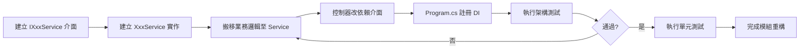

# ERP 模組地圖 (Module Map)

> 本文件定義 ERP 各業務模組的範圍、目錄位置與重構狀態。

## 1. 模組總覽

| 模組 | 中文名 | 模型目錄 | 控制器數量 | 重構狀態 |
|------|--------|----------|------------|----------|
| Inventory | 庫存管理 | `Models/Inventory` | ~15 | ⏳ 待重構 |
| Procurement | 採購管理 | `Models/Procurement` | ~12 | ⏳ 待重構 |
| Sales | 銷售管理 | `Models/Sales` | ~10 | ⏳ 待重構 |
| HR | 人力資源 | `Models/HR` | ~10 | ⏳ 待重構 |
| Manufacturing (MES) | 生產製造 | `Models/MES` | ~10 | ⏳ 待重構 |
| Finance | 財務管理 | `Models/Finance` | ~8 | ⏳ 待重構 |
| Quality (QA) | 品質管理 | `Models/QA` | ~4 | ⏳ 待重構 |
| RD | 研發工程 | `Models/RD` | ~4 | ⏳ 待重構 |
| Budget | 預算管理 | `Models/Budget` | ~3 | ⏳ 待重構 |
| Asset | 固定資產 | `Models/Asset` | ~3 | ⏳ 待重構 |
| Digital | 數位轉型 | `Models/Digital` | ~3 | ⏳ 待重構 |
| ESG | 永續發展 | `Models/ESG` | ~2 | ⏳ 待重構 |
| Portal | 供應商/客戶協作 | `Models/Portal` | ~2 | ⏳ 待重構 |
| System | 系統管理 | `Models/System` | ~5 | ⏳ 待重構 |
| Collaboration | 內部協作 | `Models/Collaboration` | ~2 | ⏳ 待重構 |

## 2. 重構順序

依建議採用增量式重構，每個模組完成後立即驗證：

```
Inventory → Procurement → Sales → HR → Manufacturing → Finance → ...
```

### 2.1 每個模組的重構流程



## 3. 核心模組 API 清單

### 3.1 Inventory 庫存
- `GET /api/erp/inventory/transactions`
- `POST /api/erp/inventory/transactions`
- `GET /api/erp/skus`
- `POST /api/erp/skus`

### 3.2 Procurement 採購
- `GET /api/erp/purchase-orders`
- `GET /api/erp/suppliers`
- `GET /api/erp/purchase-requisitions`

### 3.3 Sales 銷售
- `GET /api/erp/sales-orders`
- `GET /api/erp/customers`
- `GET /api/erp/quotes`

### 3.4 HR 人力資源
- `GET /api/erp/employees`
- `GET /api/erp/leave-requests`
- `GET /api/erp/attendance`

## 4. 服務層現況

| 指標 | 數值 | 目標 |
|------|------|------|
| 服務介面數 | 31 | ≥ 全部服務 |
| 未實作介面的服務 | 8 | 0 |
| 大型服務 (>500 行) | 6 | 拆分至 <500 |

## 5. 控制器現況

| 指標 | 數值 | 目標 |
|------|------|------|
| 控制器總數 | 84 | - |
| 直接依賴 DbContext | 73 (87%) | 0 |
| 使用服務層 | 18 (21%) | 84 (100%) |

