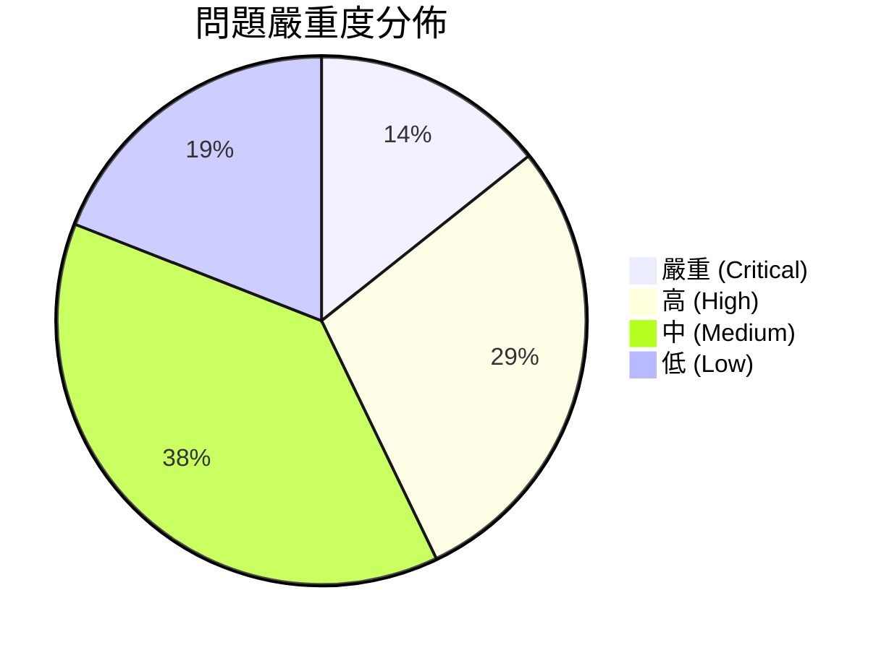
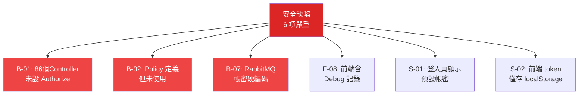
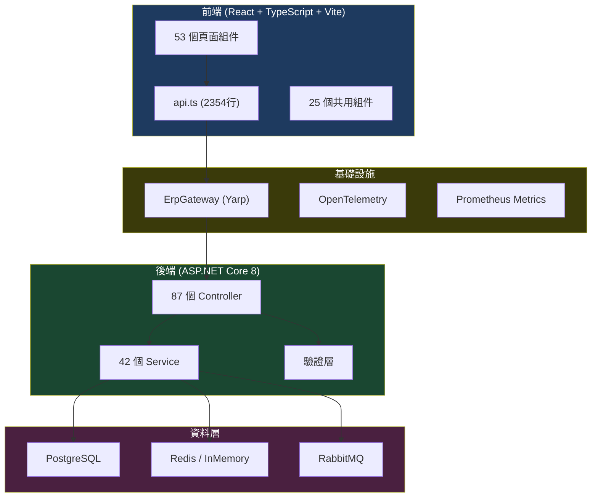

# 🏥 ERP 專案全面健康檢測報告

> **檢測日期**: 2026-04-29  
> **專案版本**: ProMES ERP v1.0  
> **技術棧**: React + TypeScript (Vite) / ASP.NET Core 8 / PostgreSQL / RabbitMQ  
> **報告版本**: v1.0

---

## 📊 總體評估

| 指標 | 分數 | 評級 |
|------|------|------|
| **前端品質** | 68/100 | ⚠️ 中等 |
| **API 設計** | 72/100 | ⚠️ 中等 |
| **後端架構** | 78/100 | ✅ 尚可 |
| **資料庫設計** | 82/100 | ✅ 良好 |
| **安全性** | 55/100 | 🔴 需改善 |
| **工程衛生** | 60/100 | ⚠️ 中等 |
| **整體健康** | **69/100** | **⚠️ 需要系統性修護** |

---

## 一、前端表單與元件分析

### 1.1 路由架構問題

> [!CAUTION]
> `App.tsx` 使用 `switch/case` 手動路由而非 React Router 動態路由，違反 SPA 最佳實踐

| # | 問題 | 嚴重度 | 位置 |
|---|------|--------|------|
| F-01 | **雙重路由系統衝突** — 同時使用 `switch/case`（L182-226）及 React Router `<Routes>` 路由，主模組不支援 URL 直連 | 🔴 嚴重 | [App.tsx](file:///d:/ERP/erp-frontend/src/App.tsx#L174-L269) |
| F-02 | **重複登入檢查** — `currentUser` 檢查在 L180 和 L249 各做一次，L249 永遠不會觸發 | ⚠️ 中 | [App.tsx](file:///d:/ERP/erp-frontend/src/App.tsx#L180) |
| F-03 | **useLocation 在條件渲染外呼叫** — `useLocation()` 必須在組件頂層呼叫，但實際放在 `renderPage` 之後 | ⚠️ 高 | [App.tsx](file:///d:/ERP/erp-frontend/src/App.tsx#L231) |

### 1.2 頁面檔案品質

| # | 問題 | 嚴重度 | 位置 |
|---|------|--------|------|
| F-04 | **巨型元件反模式** — `HR.tsx`（81KB）、`Inventory.tsx`（67KB）、`Procurement.tsx`（62KB）超過合理大小（建議 <15KB），混合多個子功能缺乏拆分 | ⚠️ 高 | `src/pages/` |
| F-05 | **表單驗證不一致** — 部分頁面使用前端內聯驗證、部分依賴後端 400 錯誤回傳，缺乏統一 Zod schema | ⚠️ 高 | 全域 |
| F-06 | **空 catch 區塊** — 4 處 `catch {}` 吞掉錯誤不做任何處理 | ⚠️ 中 | `App.tsx:124`, `AI.tsx:590`, `AgentFlows.tsx:212`, `SupplierPortal.tsx:64` |

### 1.3 殘留檔案與工程衛生

| # | 問題 | 嚴重度 | 位置 |
|---|------|--------|------|
| F-07 | **7 個殘留垃圾檔案** — `.backup2`, `.work`, `.bak`, `.fixed`, `.py` 修復腳本散落 src 目錄 | ⚠️ 低 | `src/App.tsx.backup2`, `src/api/api.ts.bak`, `src/components/Sidebar.tsx.fixed`, `src/api/*.py` |
| F-08 | **生產環境 console.log** — `api.ts` 包含 3 個 `[DEBUG]` 記錄且 `employeesApi.update` 含除錯 log | ⚠️ 中 | [api.ts](file:///d:/ERP/erp-frontend/src/api/api.ts#L479-L491) |

---

## 二、API 層分析

### 2.1 型別安全問題

> [!WARNING]
> 前端 API 層大量使用 `unknown` 和隱含 `any`，違反專案 TypeScript 嚴格型別規範

| # | 問題 | 嚴重度 | 位置 |
|---|------|--------|------|
| A-01 | **API 回傳大量使用 `unknown`** — `jobTitlesApi`, `jobGradesApi`, `costCentersApi`, `quotesApi`, `deliveryOrdersApi`, `invoicesApi` 等超過 20+ API 函數使用 `unknown[]` 泛型 | 🔴 嚴重 | [api.ts](file:///d:/ERP/erp-frontend/src/api/api.ts) |
| A-02 | **RCCP API 使用 `any`** — `rccpApi` 全部方法直接用 `any` 參數和回傳型別 | 🔴 嚴重 | [api.ts:878-885](file:///d:/ERP/erp-frontend/src/api/api.ts#L878-L885) |
| A-03 | **financeApi.getVouchers 使用 `any[]`** | ⚠️ 中 | [api.ts:948](file:///d:/ERP/erp-frontend/src/api/api.ts#L948) |
| A-04 | **costingApi.summary 使用 `any[]`** | ⚠️ 中 | [api.ts:1099](file:///d:/ERP/erp-frontend/src/api/api.ts#L1099) |

### 2.2 路由大小寫不一致

| # | 問題 | 嚴重度 | 位置 |
|---|------|--------|------|
| A-05 | **API 路由命名不統一** — 混用 PascalCase (`/GoodsReceipts`, `/WorkOrders`, `/Attendance`, `/Payroll`) 與 kebab-case (`/delivery-orders`, `/cost-centers`)，後端有 KebabCaseTransformer 但前端部分硬寫 PascalCase | ⚠️ 高 | 全域 API 呼叫 |
| A-06 | **toPascalCase 使用不一致** — 部分 API 方法用 `toPascalCase()` 包裝 request body，部分直接傳送，邏輯混亂 | ⚠️ 中 | [api.ts](file:///d:/ERP/erp-frontend/src/api/api.ts) |

### 2.3 API 檔案規模

| # | 問題 | 嚴重度 | 位置 |
|---|------|--------|------|
| A-07 | **單一 API 檔案過大** — `api.ts` 達 2354 行/110KB，已有獨立 `procurementApi.ts` 但未完成拆分 | ⚠️ 高 | [api.ts](file:///d:/ERP/erp-frontend/src/api/api.ts) |

---

## 三、後端程式分析

### 3.1 控制器安全

> [!CAUTION]
> 87 個 Controller 中僅 1 個使用 `[Authorize]`，所有 API 端點幾乎全部暴露

| # | 問題 | 嚴重度 | 位置 |
|---|------|--------|------|
| B-01 | **授權裝飾器缺失** — 僅 `EsgController.cs` 有 `[Authorize]`，其餘 86 個 Controller 未設定認證保護。雖有 JWT 設定，但端點未強制要求 | 🔴 嚴重 | [Controllers/](file:///d:/ERP/ErpBackend/Controllers/) |
| B-02 | **缺乏細粒度權限控制** — 已定義 `AdminOnly`, `DeptManager` 等 Policy 但未在任何 Controller action 使用 | 🔴 嚴重 | [Program.cs:211-217](file:///d:/ERP/ErpBackend/Program.cs#L211-L217) |
| B-03 | **AllowAnonymous 端點檢查** — `SupplierPortalController` 有 3 個匿名端點，需確認是否均為公開 API | ⚠️ 中 | [SupplierPortalController.cs](file:///d:/ERP/ErpBackend/Controllers/SupplierPortalController.cs) |

### 3.2 服務層問題

| # | 問題 | 嚴重度 | 位置 |
|---|------|--------|------|
| B-04 | **巨型服務類** — `ToolFactory.cs`(46KB)、`AIPlanningService.cs`(41KB)、`MrpEngine.cs`(37KB) 程式碼過度集中 | ⚠️ 高 | [Services/](file:///d:/ERP/ErpBackend/Services/) |
| B-05 | **EmployeesController 過大** — 單一 Controller 達 41KB，承載過多邏輯 | ⚠️ 高 | [EmployeesController.cs](file:///d:/ERP/ErpBackend/Controllers/EmployeesController.cs) |
| B-06 | **Fail 回傳使用 base.Ok** — `BaseController.Fail()` 方法回傳 HTTP 200 + `success:false`，違反 REST 語義 | ⚠️ 中 | [BaseController.cs:17-21](file:///d:/ERP/ErpBackend/Controllers/BaseController.cs#L17-L21) |

### 3.3 基礎設施

| # | 問題 | 嚴重度 | 位置 |
|---|------|--------|------|
| B-07 | **RabbitMQ 硬編碼帳密** — `guest/guest` 直接寫在程式碼中 | 🔴 嚴重 | [Program.cs:139-140](file:///d:/ERP/ErpBackend/Program.cs#L139-L140) |
| B-08 | **兩套錯誤處理 middleware** — `GlobalExceptionMiddleware.cs` + `ErrorHandlingMiddleware.cs` 兩層攔截可能重複處理 | ⚠️ 中 | [Middleware/](file:///d:/ERP/ErpBackend/Middleware/) |
| B-09 | **開發環境 Seed 無保護** — 啟動時自動遷移資料庫（L292），生產環境不適宜 | ⚠️ 高 | [Program.cs:286-394](file:///d:/ERP/ErpBackend/Program.cs#L286-L394) |

---

## 四、資料庫架構分析

### 4.1 架構評估

> [!NOTE]
> DbContext 總計管理 **150+** 個 DbSet，對應完整的 ERP 業務領域

| # | 問題 | 嚴重度 | 位置 |
|---|------|--------|------|
| D-01 | **單一 DbContext 過載** — `ErpGeneralDbContext` 包含全部實體，建議按模組拆分 Bounded Context | ⚠️ 高 | [ErpGeneralDbContext.cs](file:///d:/ERP/ErpBackend/Data/ErpGeneralDbContext.cs) |
| D-02 | **OnModelCreating 巨大** — 744 行的建構方法，難以維護 | ⚠️ 中 | [ErpGeneralDbContext.cs](file:///d:/ERP/ErpBackend/Data/ErpGeneralDbContext.cs) |
| D-03 | **DbSet 宣告風格混合** — 部分使用 `=> Set<T>()`，部分使用 `{ get; set; } = null!` | ⚠️ 低 | [ErpGeneralDbContext.cs:138-141](file:///d:/ERP/ErpBackend/Data/ErpGeneralDbContext.cs#L138-L141) |

### 4.2 索引與關聯

> [!TIP]
> 資料庫索引設計整體良好，所有業務編號欄位均有 Unique Index

| 優點 | 說明 |
|------|------|
| ✅ 完整的唯一索引 | 所有業務編號 (OrderNumber, PoNumber 等) 均設 Unique |
| ✅ 複合索引 | 查詢常用的組合欄位有複合索引 |
| ✅ 關聯完整 | FK 關係定義清晰，Cascade/Restrict 控制得當 |
| ✅ Snake_case 自動轉換 | 最終對映 PostgreSQL 命名慣例 |
| ✅ 多租戶過濾器 | 全域 Query Filter 自動套用 TenantId |

### 4.3 資料庫待優化

| # | 問題 | 嚴重度 | 位置 |
|---|------|--------|------|
| D-04 | **Shadow Property 強制注入** — 自動為所有實體加入 `Status`, `CreatedBy`, `ModifiedBy` 等 shadow property，即使某些實體不需要 | ⚠️ 低 | [ErpGeneralDbContext.cs:352-378](file:///d:/ERP/ErpBackend/Data/ErpGeneralDbContext.cs#L352-L378) |
| D-05 | **缺少 Composite Index** — 高頻查詢如「倉庫 + SKU + 批號」缺少複合索引 | ⚠️ 中 | Inventory 模組 |

---

## 五、安全性分析

| # | 問題 | 嚴重度 | 說明 |
|---|------|--------|------|
| S-01 | **登入頁明文顯示預設帳密** | 🔴 嚴重 | `預設帳號: admin / 密碼: admin123` 顯示在 UI 上 ([App.tsx:167](file:///d:/ERP/erp-frontend/src/App.tsx#L167)) |
| S-02 | **JWT Token 存 localStorage** | ⚠️ 高 | 易受 XSS 攻擊，建議改用 HttpOnly Cookie |
| S-03 | **401 時自動清除並重載** | ⚠️ 中 | `api.ts:12-14` 直接 `window.location.reload()` 無 debounce，可能導致重載循環 |

---

## 六、流程架構總覽

---

## 七、分階段修護計劃

### Phase 1：安全緊急修復 (1-2 天)

> [!IMPORTANT]
> 此階段為最高優先級，必須立即處理

| 項目 | 對應問題 | 工作內容 | 預估時間 |
|------|----------|----------|----------|
| 1.1 | B-01, B-02 | 為 `BaseController` 加上 `[Authorize]`，僅 Auth/Health 端點設 `[AllowAnonymous]` | 2hr |
| 1.2 | B-07 | RabbitMQ 帳密移入環境變數 | 30min |
| 1.3 | S-01 | 移除登入頁預設帳密提示 | 15min |
| 1.4 | F-08 | 清除前端所有 `[DEBUG]` console.log | 30min |

### Phase 2：型別安全強化 (3-5 天)

| 項目 | 對應問題 | 工作內容 | 預估時間 |
|------|----------|----------|----------|
| 2.1 | A-01, A-02 | 定義全部缺失的 DTO interface，替換 `unknown` / `any` | 3 天 |
| 2.2 | A-05 | 統一 API 路由為 kebab-case，前端全面改寫 | 1 天 |
| 2.3 | A-06 | 建立統一的 request body 轉換策略 | 0.5 天 |

### Phase 3：工程衛生清理 (1-2 天)

| 項目 | 對應問題 | 工作內容 | 預估時間 |
|------|----------|----------|----------|
| 3.1 | F-07 | 刪除所有 `.backup`, `.bak`, `.work`, `.fixed`, `.py` 殘留檔 | 30min |
| 3.2 | F-06 | 空 `catch {}` 加上適當錯誤處理/使用者提示 | 1hr |
| 3.3 | B-08 | 合併或理清兩套 Exception Middleware | 2hr |
| 3.4 | D-03 | 統一 DbSet 宣告風格 | 1hr |

### Phase 4：架構重構 (1-2 週)

| 項目 | 對應問題 | 工作內容 | 預估時間 |
|------|----------|----------|----------|
| 4.1 | F-01 | 將 `switch/case` 模組路由改為 React Router `<Route>`，支援 URL 直連 | 2 天 |
| 4.2 | A-07 | 將 `api.ts` 按模組拆分 (`salesApi.ts`, `hrApi.ts`, `inventoryApi.ts`...) | 1.5 天 |
| 4.3 | F-04 | 拆分巨型頁面 (`HR.tsx`, `Inventory.tsx`, `Procurement.tsx`) 為子組件 | 3 天 |
| 4.4 | F-05 | 建立統一 Zod 表單驗證架構 | 2 天 |
| 4.5 | B-05 | 拆分 `EmployeesController` 為多個子 Controller | 1 天 |
| 4.6 | D-01 | 評估 DbContext 拆分為 Bounded Context | 3 天 |

### Phase 5：生產環境就緒 (3-5 天)

| 項目 | 對應問題 | 工作內容 | 預估時間 |
|------|----------|----------|----------|
| 5.1 | B-09 | 將 Seed 邏輯用 `IsDevelopment()` 保護，生產禁用自動 Migrate | 1hr |
| 5.2 | S-02 | JWT Token 改用 HttpOnly Secure Cookie | 1 天 |
| 5.3 | B-06 | `Fail()` 改回 HTTP 4xx 狀態碼 | 1 天 |
| 5.4 | D-05 | 依據查詢模式補充複合索引 | 1 天 |
| 5.5 | — | 加入 Rate Limiting middleware | 0.5 天 |
| 5.6 | — | API 加入 Response Compression | 0.5 天 |

---

## 八、問題統計摘要

| 嚴重度 | 數量 | 類別分佈 |
|--------|------|----------|
| 🔴 嚴重 | 6 | 安全 ×4, API 型別 ×2 |
| ⚠️ 高 | 12 | 架構 ×5, 安全 ×2, 前端 ×3, API ×2 |
| ⚠️ 中 | 16 | 前端 ×4, API ×4, 後端 ×4, DB ×2, 安全 ×2 |
| ⚠️ 低 | 8 | 工程衛生 ×5, DB ×3 |
| **總計** | **42** | |

---

## 九、正面發現 ✅

雖然有待改善之處，專案也有許多優秀設計值得肯定：

| 領域 | 亮點 |
|------|------|
| **TypeScript 編譯** | `tsc --noEmit` **零錯誤**，型別系統運作正常 |
| **資料庫設計** | 索引全面、關聯清晰、Snake_case 自動映射、多租戶過濾器 |
| **事件驅動** | MassTransit + RabbitMQ 事件驅動架構成熟 |
| **可觀察性** | OpenTelemetry + Prometheus + Request Logging 三套監控 |
| **API 標準化** | 統一 `ApiResponse<T>` 回應格式、統一分頁/搜尋/排序參數 |
| **前端 Lazy Loading** | 所有頁面組件均使用 `React.lazy` + `Suspense` |
| **後端驗證** | 完整的 `ValidationRules` 框架含多種規則型別 |
| **審計追蹤** | `AuditInterceptor` + `AuditLogFilter` 雙層審計 |
| **多租戶** | DbContext 全域 Query Filter + TenantProvider |
| **Code Convention** | 後端 kebab-case URL 自動轉換 |

---

> [!NOTE]
> 本報告基於靜態程式碼分析，建議搭配實際運行測試進一步驗證。如需立即開始修復任何特定項目，請告知優先順序。
